# Verificación de la auditoría UX/UI

> Cierre del backlog `docs/backlog-ux-ui.md` (tickets 6.1 y 6.2), el 2026-10-14, sobre `main` en
> `62fe431` más los arreglos del propio paso 25. Se compara con la línea base que se tomó antes de
> empezar (`tools/ux/linea-base/`, 2026-10-08, `main` en `e6873fe`). Las métricas finales y las
> ocho capturas de «después» están versionadas en `tools/ux/final/`.
>
> Los datos son los de desarrollo: la identidad real del colectivo, sus 12 integrantes y el
> material visual genérico (`docs/contenido-visual.md`).

## 1. En una página

De los doce grupos de criterios de §10 de `docs/auditoria-ux-ui.md`:

- **Se cumplen**: el ancho que ocupa el texto, la jerarquía, el contraste, las imágenes, el
  rendimiento, la navegación de las fichas y casi toda la accesibilidad.
- **No se cumplen por decisión del dueño del sitio**, que vio la alternativa y eligió otra cosa:
  - el alto de la portada (4092 px, la meta era 3300);
  - el control de pausa de la cinta;
  - las cifras en la portada;
  - la densidad de tinta de su primera pantalla.
- **No se cumplen y quedan anotados con su causa**, en `docs/deferidos-y-decisiones.md`:
  - la monoespaciada y las mayúsculas de la portada;
  - los 10 tamaños de la escala (eran 8 en la meta);
  - la medida del manifiesto en el dossier;
  - el alto de los enlaces del pie;
  - la tinta de los índices de filas.

Lo que más cambió, a 1440 px:

| | Antes | Ahora |
|---|---|---|
| Ancho que ocupa el texto | 0,47 a 0,54 | 0,89 a 0,98 |
| Título de un índice | 12 px | 56 px |
| Letras por línea en un artículo | 102 | 62 |
| Textos de menos de 12 px | 10 a 29 por página | 0 |
| Imágenes deformadas o mal recortadas | 18, en cinco páginas | 0 |
| Imágenes en la primera pantalla de la portada | 0 | 2 |
| Elementos en monoespaciada en la portada | 72 % | 38 % |

## 2. Los criterios de §10, uno por uno

«Cumple» quiere decir medido y dentro de la meta. Los números salen de `tools/ux` (capturas a
1440, 390 y 1920; `metrics.py comparar tools/ux/linea-base tools/ux/final`) y de las pruebas de
`backend/tests/`, salvo donde se dice otra cosa.

### Espacio

| Criterio | Meta | Antes | Ahora | Estado |
|---|---|---|---|---|
| Ancho del texto a 1440, portada e índices | ≥ 0,85 | 0,47 a 0,54 | 0,90 a 0,98 (portada 0,98) | cumple |
| Ancho del texto a 1440, fichas | ≥ 0,80 | 0,37 a 0,51 | 0,90 a 0,92 | cumple |
| Ancho del texto a 1440, poema y artículo | ≥ 0,60 | 0,47 y 0,51 | 0,90 y 0,90 | cumple |
| Ancho del texto a 1920, índices | ≥ 0,65 | 0,35 a 0,40 | 0,74 y 0,75 | cumple |
| Tinta en la primera pantalla, portada | ≥ 50 % | 30 % | 16,5 % | **no cumple**: decisión del dueño (abajo) |
| Tinta en la primera pantalla, índices | ≥ 20 % | 4,8 % en poemas | 7 de 11 índices entre 29 % y 47 %; textos 9,3, agenda 8,6, trayectoria 5,5, aliados 3,3 | **en parte** (abajo) |

**Cómo se mide la tinta.** Se cuenta la proporción de píxeles de la primera pantalla cuyo color
se aparta en más de 12 (en algún canal) del color dominante, que es el papel. Se toma uno de cada
cuatro píxeles en cada eje. Es el método de la auditoría: sobre la captura de la línea base da
4,8 % en poemas, la misma cifra que ella anotó, y 30 % en la portada, donde anotó 33.

**Por qué la portada baja.** La de antes tenía una banda blanca bajo el titular, y el método la
cuenta como tinta. La de ahora es papel de lado a lado: el nombre a 124 px, la cubierta del
catálogo y el manifiesto. El dueño descartó, al verlos, los planos de color y las bandas oscuras
en el cuerpo de la portada (paso 13), y después quitó las cifras y la cita de prensa (#128, #129).
Eso era lo que habría subido la cifra. Lo que pedía este criterio, que la página no se viera
vacía, lo mide mejor el ancho: la portada usa el 98 % de la pantalla.

**Por qué cuatro índices quedan bajo el 20 %.** Textos, agenda, trayectoria y aliados son listas
de filas tipográficas sobre el papel, con poca imagen:
- en textos, solo los que tienen imagen llevan miniatura;
- en la agenda de desarrollo no hay ningún evento futuro;
- la trayectoria abre con su tira de cifras;
- aliados son tres logos en gris.

Los índices con imágenes (integrantes, registros, publicaciones, galería) están entre 39 % y 47 %.

### Lectura y jerarquía

| Criterio | Meta | Antes | Ahora | Estado |
|---|---|---|---|---|
| Letras por línea, cuerpo de artículo | 60 a 75 | 102 | 62 | cumple |
| Letras por línea, bajada de un índice | 60 a 75 | — | 64 | cumple |
| Letras por línea, sumario de la portada | 60 a 75 | — | 66 | cumple |
| Letras por línea, manifiesto del dossier | 60 a 75 | — | 49 | **no cumple** (abajo) |
| Poema con `fit-content` y sangría de continuación | sí | no | sí | cumple (`test_un_verso_largo_continua_con_sangria_francesa`) |
| `h1` de un índice | ≥ 36 px y ≥ 1,3 × el `h3` de tarjeta | 12 px | 56 px, 2,15 × (34 px en el teléfono, 1,5 ×) | cumple en escritorio |
| Ningún encabezado menor que el texto que encabeza | sí | no | sí | cumple (`test_un_titulo_de_seccion_no_mide_menos_que_el_texto_que_encabeza`) |
| Texto mínimo | 12 px | 10 a 29 elementos por página por debajo | 0 | cumple |
| Escala en `:root` | 8 tamaños, 5 interlíneas, 3 espaciados | 25 tamaños sueltos | 10 tamaños, 5 interlíneas, 3 espaciados | **en parte** (abajo) |

**El manifiesto del dossier** va al lado de la ficha, a dos columnas, en la columna de lectura
del dossier (paso 22): 49 letras por línea, dentro de lo legible (45 a 75) pero bajo la meta
de 60. **La escala tiene 10 pasos**: el 13 del dato y el 15 de la interfaz, que pedían la
navegación y el pie, y el 16 de los campos de formulario, por debajo del cual iOS amplía la página
al enfocarlos (ticket 2.3).

### Voz

| Criterio | Meta | Antes | Ahora | Estado |
|---|---|---|---|---|
| Elementos en monoespaciada en la portada | ≤ 30 % | 72 % | 38 % | **no cumple** (abajo) |
| Elementos en mayúsculas en la portada | ≤ 15 | 30 | 26 | **no cumple** (abajo) |
| La misma familia de lectura en Linux, macOS, Windows y Android | sí | no: Liberation, Palatino, Iowan, Noto | sí: «RdV Serif» y Syne, autoalojadas | cumple |

Lo que queda en monoespaciada y en mayúsculas son rótulos y datos, como fija D3. Casi la mitad son
los cargos de la cinta de integrantes, que se repite entera para dar la vuelta sin costura: cada
cargo cuenta dos veces. Por letras, la monoespaciada es el 29 % de la portada. El cargo pasó a
rótulo en el ticket 3.6, y el dueño lo aprobó al ver el paso 14.

### Contraste

| Criterio | Meta | Ahora | Estado |
|---|---|---|---|
| Todo texto contra el fondo que tiene debajo | ≥ 4,5:1 (3:1 si es grande) | 0 textos por debajo, en las 21 páginas a 1440, 951 y 390 (`superficies.js`) | cumple |
| Foco y bordes de los controles | ≥ 3:1 | los pares de la paleta, en `test_contraste_paleta.py`; foco magenta de 2 px | cumple |

### Objetivos pulsables

| Criterio | Meta | Antes | Ahora | Estado |
|---|---|---|---|---|
| Enlaces de la barra (escritorio) | ≥ 44 px | 23 px | 45 px (arreglado en el paso 25) | cumple |
| Sub-fila del colectivo | ≥ 44 px | 43 px | 45 px | cumple |
| Botones y lupa | ≥ 44 px | — | 44 px | cumple |
| Paginación | ≥ 44 px | — | `min-height:44px` | cumple |
| Enlaces del pie | ≥ 44 px | — | de 17 a 21 px de alto, a 28 px uno de otro | **no cumple** (abajo) |
| Tamaño de objetivo, WCAG 2.5.8 (AA) | ningún fallo | — | 0 fallos en 821 objetivos a 1440 y 822 a 390 | cumple |

**El pie.** Sus enlaces cumplen 2.5.8 por separación: el círculo de 24 px de cada uno no toca el de
al lado. Darles 44 px alargaría cada columna de cinco enlaces en 80 px (cinco por la diferencia
entre 44 y 28), y el dueño pidió un pie bajo (paso 13).

**Cómo se mide 2.5.8.** Un objetivo de menos de 24 × 24 px cumple si el círculo de 24 px centrado
en él no toca otro objetivo, ni el círculo de otro objetivo pequeño. También cumple si es un
enlace dentro de una frase. El comprobador se validó con una página de control con dos botones de
12 px pegados, que marca, y un enlace en línea, que deja pasar.

### Imágenes

| Criterio | Meta | Antes | Ahora | Estado |
|---|---|---|---|---|
| Imágenes en la primera pantalla de la portada (1440, 1920, 390) | ≥ 1 | 0, 0, 0 | 2, 2, 1 | cumple |
| Proporción pintada igual a la pedida (±2 %) | todas | 18 desviadas (portada 3, galería 4, evento 7, publicaciones 3, una publicación 1) | 0 | cumple |
| Póster o carátula en las placas del reproductor | 100 % | placas azules vacías | 100 % (paso 15) | cumple |
| Integrantes con retrato | 100 % | — | 12 de 12 | cumple, con material genérico |
| Eventos con afiche o foto | 100 % | — | 4 de 4 | cumple, con material genérico |
| Registros con carátula | 100 % | — | 2 de 2 con póster; los demás llevarían carátula tipográfica | cumple |
| Imagen para compartir (`og_image`) | definida | — | definida | cumple |

Las fotos, afiches y cubiertas son material genérico hasta que el colectivo aporte el suyo.

### Rendimiento

| Criterio | Meta | Ahora | Estado |
|---|---|---|---|
| LCP de la portada en un teléfono | ≤ 2,5 s | 2,1 s | cumple, con reservas (abajo) |
| CLS | < 0,1 | 0 | cumple |
| Peso de las fuentes autoalojadas | ≤ 200 KB | 120 KB (`test_las_fuentes_caben_en_su_presupuesto`) | cumple |
| Consultas de la portada | ≤ 24 | 16 en frío (`test_performance.py`) | cumple |

**LCP y CLS** se midieron con Chrome a 390 × 844, con la red de un 4G lento (1,6 Mbit/s, 150 ms) y
la CPU cuatro veces más lenta, contra el servidor de desarrollo. No es Lighthouse ni la vista
previa de producción: allí los estáticos van comprimidos y con caché, así que debería ser mejor.
Conviene repetirlo en producción.

### Accesibilidad y navegación

| Criterio | Meta | Ahora | Estado |
|---|---|---|---|
| 2.2.2: la cinta se detiene | al señalarla, con el foco dentro y con un control | se detiene al señalarla y con el foco dentro; quieta con «menos movimiento»; sin control | **en parte**: el control lo retiró el dueño (D1) |
| Panel de búsqueda dentro de la pantalla a 320 px | sí | de 20 a 300 px | cumple |
| `aria-current` en todas las páginas | sí | «page» en el índice de cada sección y en el dossier; «true» en sus fichas y subpáginas | cumple |
| Títulos de pestaña con el nombre del colectivo | 100 % | 61 de 61 páginas recorridas | cumple |
| Dossier, Textos y contacto a un clic desde cualquier página | sí | en escritorio, sí: la barra, el botón «Dossier», que lleva a `#contacto`, y el correo del pie | cumple en escritorio |
| Cada ficha con 4 o más enlaces internos en `<main>` | ≥ 4 | integrante 13, evento 10, artículo 7, registro 6, publicación 6, poema 5 | cumple |
| Agenda vacía | ≥ 3 actividades pasadas y dos acciones | 3 recientes, «Escríbenos» y «Ver el dossier» | cumple |

**En el teléfono**, Textos y el dossier están en «Menú», a dos toques: la cabecera del teléfono no
tiene sitio para los cinco enlaces (paso 18).

### Portada

| Criterio | Meta | Antes | Ahora | Estado |
|---|---|---|---|---|
| Alto a 1440 | ≤ 3300 px | 4728 | 4092 | **no cumple**: decisión del dueño (paso 20) |
| Alternancia de superficies | estricta | bandas blancas al 50 % | papel y hoja clara alternan; la tinta, solo en el pie | cumple, sin bandas de tinta por decisión del dueño |
| Versos que se leen | ≥ 3 | 0 | 6 | cumple |
| Cifras enlazadas a su prueba | sí | no enlazadas | no hay cifras en la portada | **no cumple**: las quitó el dueño (#128); están en el dossier |
| Fecha de la última actualización | visible | no | «Actualizado el …» en el cierre | cumple |

**El alto.** El dueño vio la portada con y sin el bloque de publicaciones (3841 px sin él) y eligió
conservarlo. Después pidió quitar las cifras, «Con el apoyo de» y la cita de prensa, «siendo que aún
somos un grupo pequeño».

## 3. La pasada de accesibilidad (ticket 6.1)

Hecha con Chrome y el teclado sobre las páginas reales, sin herramientas externas (axe, Lighthouse
o un lector de pantalla no están en el entorno).

| Qué | Resultado |
|---|---|
| Primer Tab | «Saltar al contenido», en la portada, un poema, un evento y el dossier |
| Foco visible | en las doce primeras paradas de esas cuatro páginas, contorno magenta de 2 px |
| La lupa | se abre con Enter; el siguiente Tab va al campo |
| «Menú» en el teléfono | se abre con Enter; el siguiente Tab va a «Integrantes» |
| Vista ampliada de una foto | Enter la abre; Tab va a «Cerrar», con el foco visible; Enter la cierra |
| «Ver las N fotos» | un `<details>`: se abre con el teclado, como cualquier otro |
| La cinta | se detiene al señalarla y con el foco en «Conoce al colectivo»; con «menos movimiento», sin animación |
| Idioma | `lang="es"` |
| Movimiento | `prefers-reduced-motion` anula toda animación y transición (`test_el_movimiento_usa_los_tokens_y_respeta_a_quien_pide_menos`) |
| Reflujo (1.4.10) | ningún scroll horizontal a 320 px en las 21 páginas |
| Tamaño de objetivo (2.5.8) | 0 fallos (arriba) |
| Contraste (1.4.3) | 0 textos por debajo de AA (arriba) |

**Arreglado aquí**: los enlaces de la barra y de la sub-fila del colectivo, de 23 y 43 px de alto a
45 (`test_los_enlaces_de_la_barra_se_pulsan_en_44_px`).

**No verificado** sin un lector de pantalla:
- cómo anuncia la región `aria-live` del panel de la lupa los resultados agrupados;
- el orden de lectura de la vista ampliada.

Queda en `docs/deferidos-y-decisiones.md`.

## 4. Las métricas, antes y después

`python3 tools/ux/metrics.py comparar tools/ux/linea-base tools/ux/final`, a 1440 px:

| Página | Ancho del texto | `h1` | Monoespaciada | Mayúsculas | Bajo 12 px | Desviadas | Alto |
|---|---|---|---|---|---|---|---|
| portada | 0,53 → 0,98 | oculto → 124 | 72 % → 38 % | 30 → 26 | 29 → 0 | 3 → 0 | 4728 → 4092 |
| textos | 0,51 → 0,92 | 12 → 56 | 81 % → 37 % | 22 → 12 | 22 → 0 | 0 | 1579 → 1516 |
| poemas | 0,47 → 0,92 | 12 → 56 | 89 % → 20 % | 12 → 5 | 12 → 0 | 0 | 900 |
| poema | 0,47 → 0,90 | 40 → 56 | 86 % → 17 % | 11 → 10 | 12 → 0 | 0 | 1086 → 960 |
| artículo | 0,51 → 0,90 | 46 → 40 | 81 % → 25 % | 13 → 11 | 13 → 0 | 0 | 1089 → 1461 |
| integrantes | 0,53 → 0,90 | 12 → 56 | 63 % → 18 % | 21 → 16 | 21 → 0 | 0 | 1245 → 2040 |
| integrante | 0,51 → 0,92 | 42 → 56 | 79 % → 27 % | 19 → 11 | 20 → 0 | 0 | 1675 → 2217 |
| registros | 0,47 → 0,90 | 12 → 56 | 91 % → 20 % | 11 → 5 | 10 → 0 | 0 | 1262 → 1126 |
| registro | 0,51 → 0,90 | 42 → 56 | 91 % → 22 % | 12 → 9 | 12 → 0 | 0 | 1213 → 1668 |
| publicaciones | 0,47 → 0,90 | 12 → 56 | 88 % → 15 % | 10 → 5 | 10 → 0 | 3 → 0 | 2003 → 1301 |
| publicación | 0,47 → 0,92 | 42 → 56 | 91 % → 26 % | 13 | 13 → 0 | 1 → 0 | 2311 → 1386 |
| agenda | 0,47 → 0,91 | 12 → 56 | 89 % → 18 % | 10 | 10 → 0 | 0 | 900 → 1493 |
| evento | 0,37 → 0,90 | 42 → 56 | 89 % → 30 % | 13 → 12 | 14 → 0 | 7 → 0 | 5884 → 2330 |
| trayectoria | 0,47 → 0,92 | 12 → 56 | 77 % → 27 % | 19 → 5 | 19 → 0 | 0 | 1409 → 2018 |
| galería | 0,49 → 0,90 | 12 → 56 | 86 % → 15 % | 10 → 5 | 10 → 0 | 4 → 0 | 3871 → 1479 |
| prensa | 0,47 → 0,92 | 12 → 56 | 86 % → 16 % | 12 → 7 | 12 → 0 | 0 | 900 → 904 |
| aliados | 0,47 → 0,90 | 12 → 56 | 88 % → 14 % | 13 → 8 | 13 → 0 | 0 | 900 → 1239 |
| colecciones | 0,47 → 0,90 | 12 → 56 | 89 % → 10 % | 10 → 5 | 10 → 0 | 0 | 900 |
| dossier | 0,53 → 0,89 | 44 → 56 | 41 % → 32 % | 18 → 33 | 18 → 0 | 0 | 2735 → 4450 |
| búsqueda | 0,54 → 0,90 | 32 → 56 | 82 % → 17 % | 12 → 6 | 13 → 0 | 0 | 900 → 931 |
| envío | 0,47 → 0,90 | 42 → 56 | 91 % → 8 % | 21 → 5 | 13 → 0 | 0 | 1427 → 1605 |

Tres cifras suben sin ser regresiones:
- **El dossier**: las mayúsculas pasan de 18 a 33 y el alto de 2735 a 4450. Son los rótulos de su
  ficha, del tipo de cada entrada de la trayectoria y del cargo de cada integrante, y ahora lleva
  retratos, cubiertas y logos.
- **Las fichas de integrante y de registro** crecen por la imagen a dos columnas y las salidas al
  pie.
- **La ficha de un evento** pasa de 5884 a 2330 px: las fotos dejaron de pintarse a 780 px de alto.

En el teléfono (390 px), el ancho del texto queda en 0,89 a 0,90 en todas las páginas (era 0,71 a
0,90), y ninguna tiene scroll horizontal ni texto de menos de 12 px.

## 5. Capturas, antes y después

La primera pantalla de la portada, un índice, un poema y una ficha, a 1440 y a 390. Las de antes no
se pueden regenerar: el código que las produjo ya cambió.

| | Antes (2026-10-08) | Después (2026-10-14) |
|---|---|---|
| Portada, 1440 | 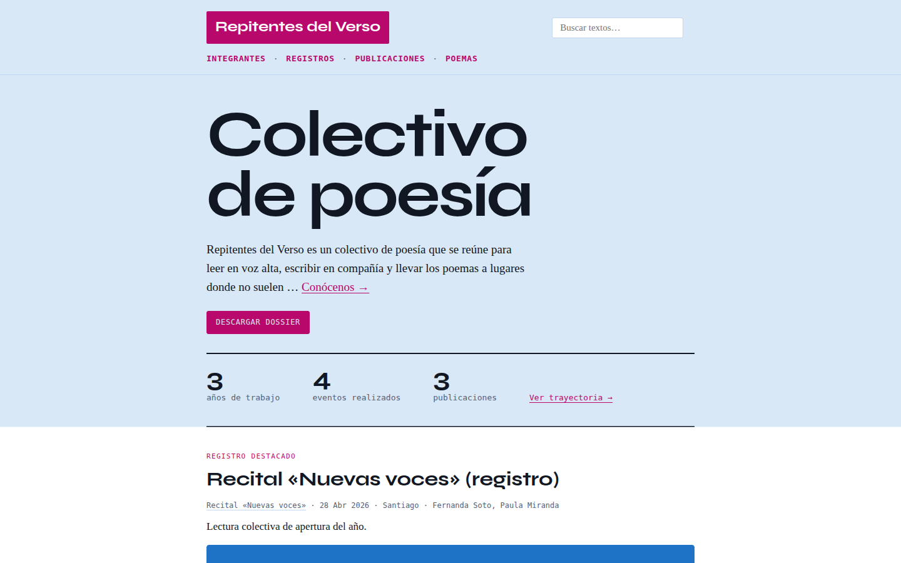 | 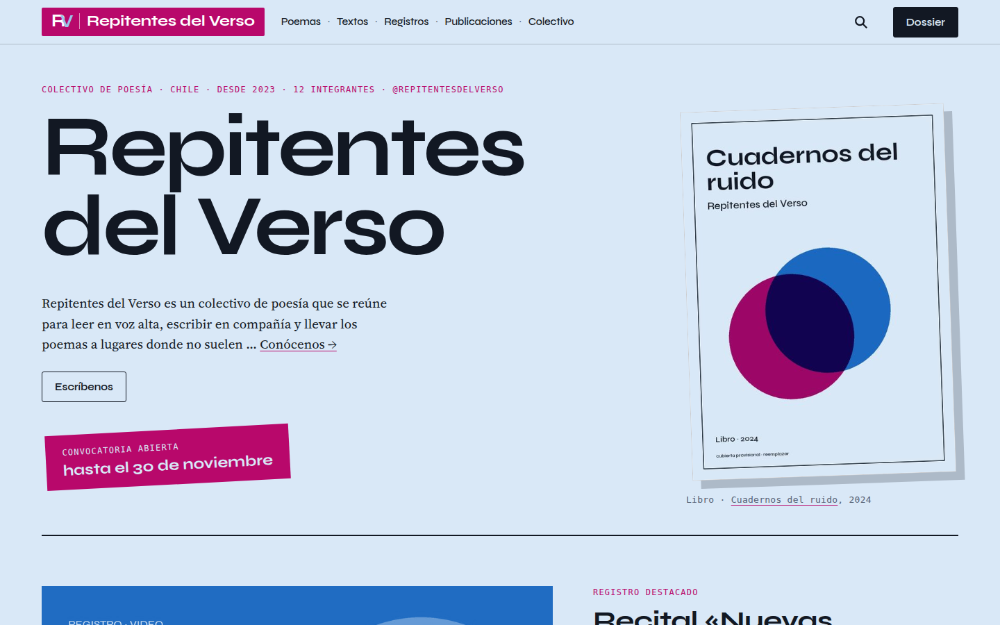 |
| Portada, 390 | 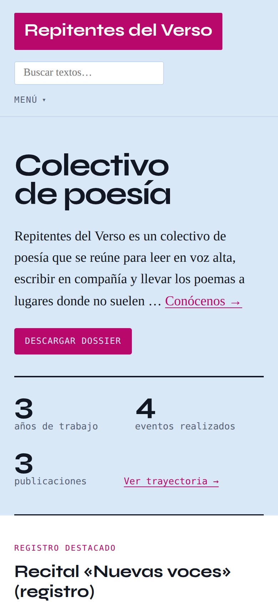 | 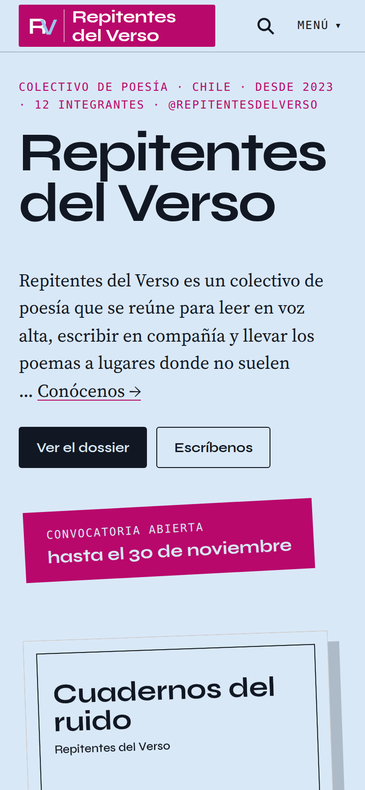 |
| Poemas, 1440 | 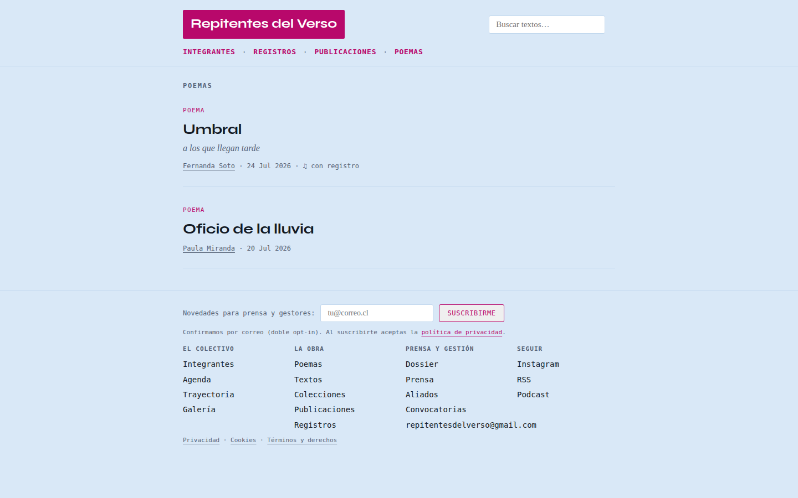 | 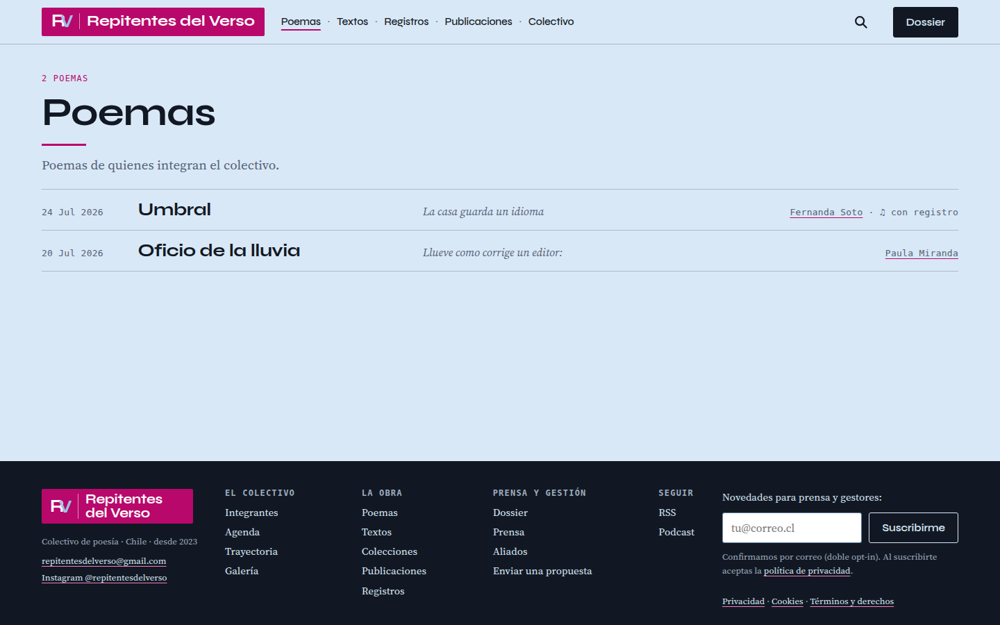 |
| Poemas, 390 | 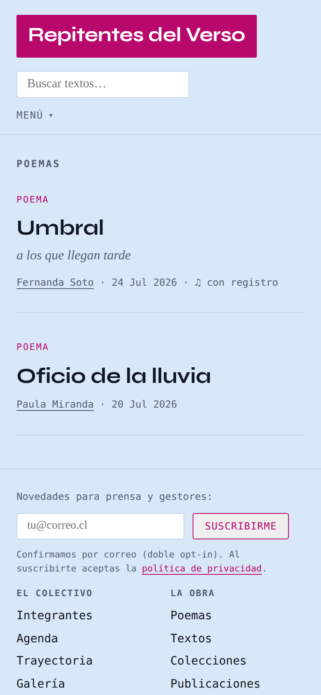 | 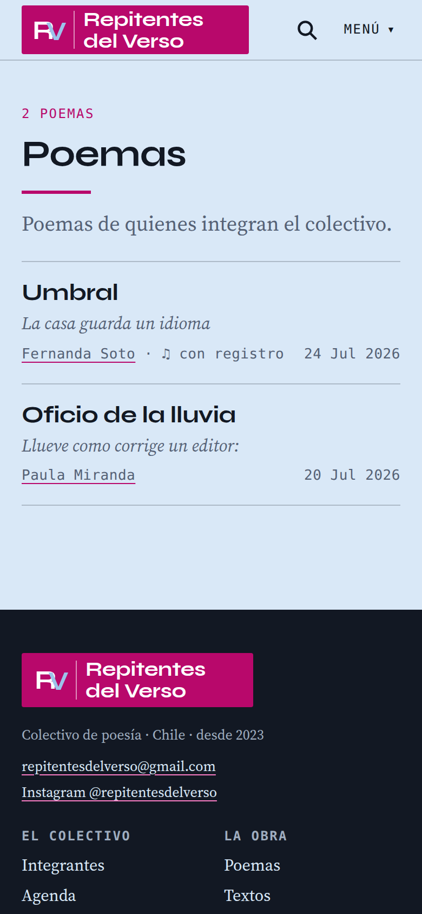 |
| Un poema, 1440 | 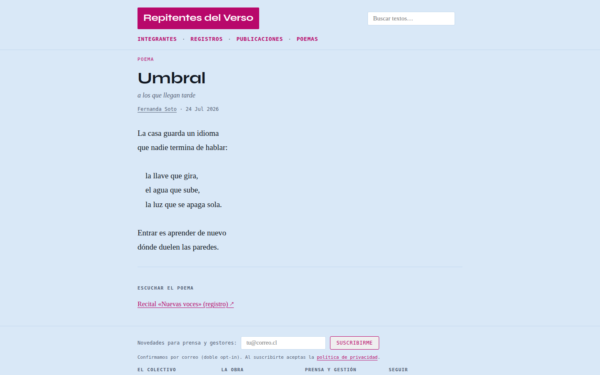 | 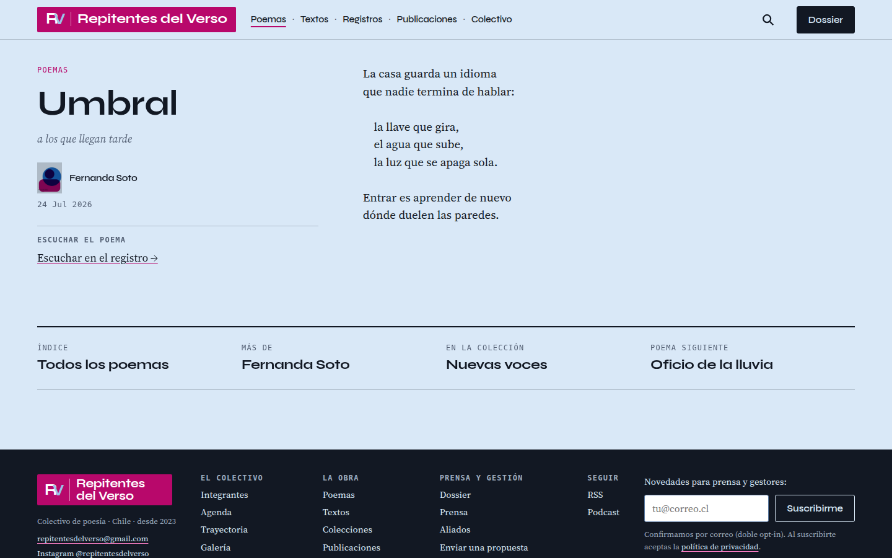 |
| Un poema, 390 | 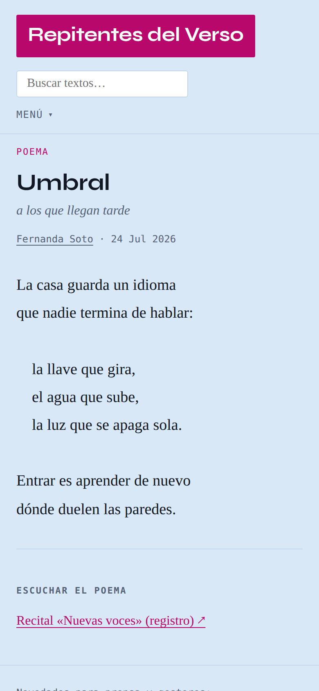 | 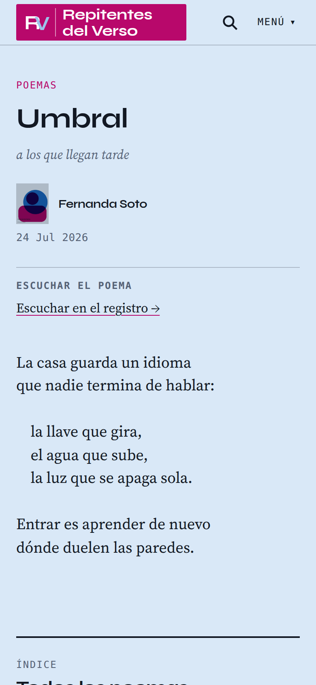 |
| Una integrante, 1440 | 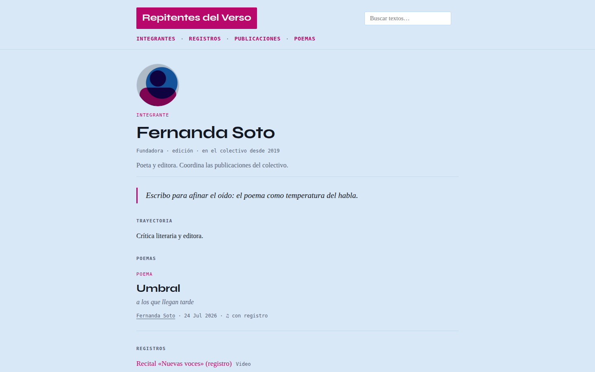 | 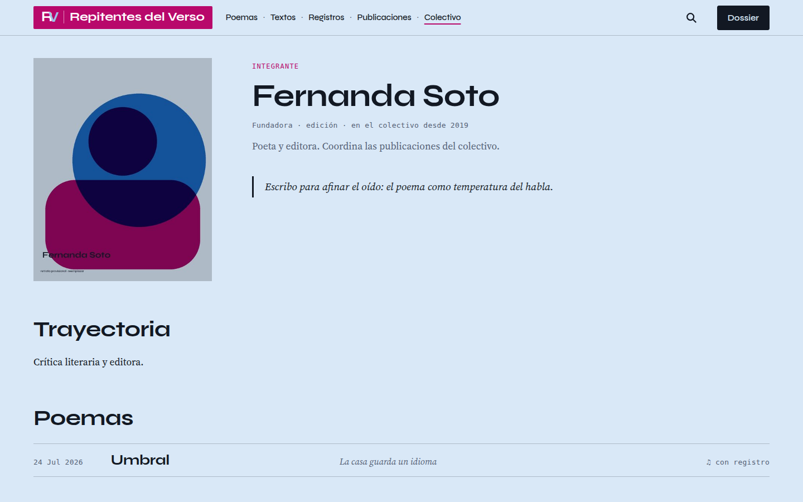 |
| Una integrante, 390 | 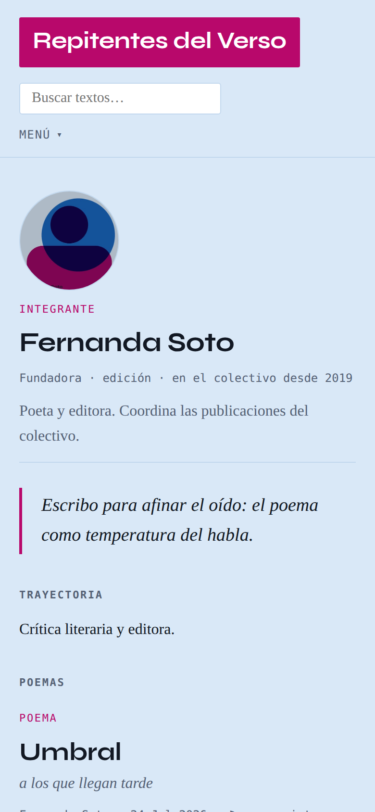 | 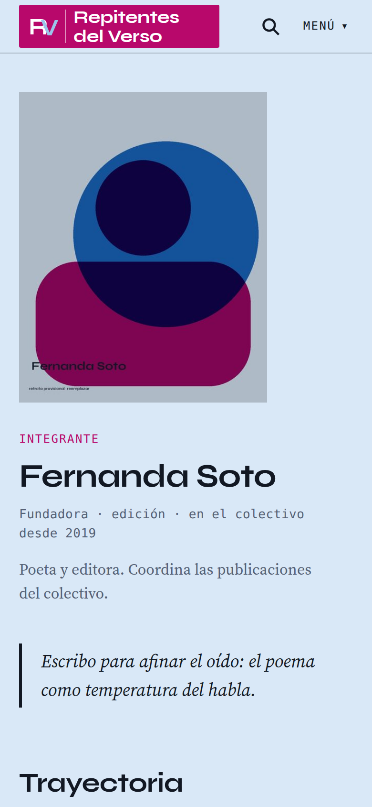 |

## 6. Después de la medida: textos largos (#136)

Antes de aprobar el cierre, el dueño del sitio pidió probar las páginas de lectura con textos
largos y cercanos a los reales. `seed_textos_largos` siembra seis textos y cinco poemas, y
recorridos a siete anchos (de 320 a 1920 px) destaparon cuatro fallos que el contenido de
demostración no podía enseñar, ya arreglados:

| Fallo | Arreglo |
|---|---|
| Un bloque preformateado (una partitura, una tabla hecha con espacios) empujaba la página hacia los lados, a cualquier ancho | se desplaza dentro de su caja |
| La columna ancla de un texto con título de 200 letras, cuatro firmas y ocho etiquetas medía 1248 px, más que la pantalla: su final quedaba fuera de la vista durante toda la lectura | si no cabe, se desplaza por dentro |
| Un título de 125 letras ocupaba catorce líneas y partía palabras por la mitad («imposibilida / d») | los títulos de más de noventa letras bajan un paso; se dividen con guion donde el navegador sabe hacerlo |
| La portada citaba tres «versos» de un poema sin tope: una oda de versos larguísimos ocupaba diez líneas, y un poema en prosa habría puesto tres párrafos | tres versos, y no más de 160 letras |

Con los arreglos, ninguna de las 25 páginas recorridas se sale de la pantalla en ningún ancho.
Queda una decisión del dueño: cómo componer un poema en prosa (`docs/deferidos-y-decisiones.md`
§4).

## 7. Cómo repetir la medida

```bash
node tools/ux/capture.js tools/ux/out/otra                       # las 21 páginas, 1440, 390 y 1920
python3 tools/ux/metrics.py comparar tools/ux/final tools/ux/out/otra
node tools/ux/superficies.js 951 900                             # tinta, amarillo, cajas, contraste
python3 tools/ux/smoke.py                                        # todas las rutas responden
```

La tinta de la primera pantalla, el tamaño de objetivo con sus excepciones, el LCP y el recorrido
con el teclado se midieron con guiones de una sola vez; el método de cada uno está descrito arriba.
